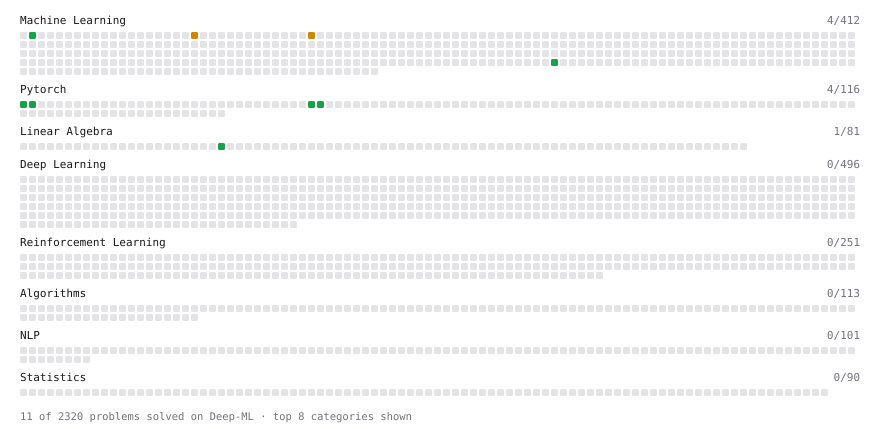

# Deep-ML

My machine learning practice from [Deep-ML](https://www.deep-ml.com). Every solution here was written by hand.

**19** solved · 13 problems · 0 labs · 6 math

[**Browse the interactive portfolio**](https://silentcodernil.github.io/deep-ml/) to replay this filling in over time.

## Problems

| | Difficulty | Solved | |
| --- | --- | --- | --- |
| [Add a Bias Vector to a Batch via Broadcasting](https://www.deep-ml.com/problems/882) | easy | 2026-11-17 | [solution](problems/0882-add-a-bias-vector-to-a-batch-via-broadcasting) |
| [Create a Float Tensor from a Python List](https://www.deep-ml.com/problems/880) | easy | 2026-11-12 | [solution](problems/0880-create-a-float-tensor-from-a-python-list) |
| [Create and Inspect a Tensor](https://www.deep-ml.com/problems/1220) | easy | 2026-11-12 | [solution](problems/1220-create-and-inspect-a-tensor) |
| [Derivative of a Polynomial](https://www.deep-ml.com/problems/116) | easy | 2026-11-11 | [solution](problems/0116-derivative-of-a-polynomial) |
| [Implement a Linear Layer Forward Pass with Matrix Multiplication](https://www.deep-ml.com/problems/883) | easy | 2026-11-17 | [solution](problems/0883-implement-a-linear-layer-forward-pass-with-matrix-multiplication) |
| [Implement Orthogonal Projection of a Vector onto a Line](https://www.deep-ml.com/problems/66) | easy | 2026-11-10 | [solution](problems/0066-implement-orthogonal-projection-of-a-vector-onto-a-line) |
| [Linear Regression Using Gradient Descent](https://www.deep-ml.com/problems/15) | easy | 2026-11-11 | [solution](problems/0015-linear-regression-using-gradient-descent) |
| [Recursive Least Squares for Simple Linear Regression](https://www.deep-ml.com/problems/1820) | easy | 2026-11-11 | [solution](problems/1820-recursive-least-squares-for-simple-linear-regression) |
| [Reshape and Transpose a Tensor](https://www.deep-ml.com/problems/1221) | easy | 2026-11-12 | [solution](problems/1221-reshape-and-transpose-a-tensor) |
| [Reshape and Transpose a Tensor](https://www.deep-ml.com/problems/881) | easy | 2026-11-17 | [solution](problems/0881-reshape-and-transpose-a-tensor) |
| [Chain Rule for Composite Functions](https://www.deep-ml.com/problems/214) | medium | 2026-11-11 | [solution](problems/0214-chain-rule-for-composite-functions) |
| [Implement Gradient Descent Variants with MSE Loss](https://www.deep-ml.com/problems/47) | medium | 2026-11-12 | [solution](problems/0047-implement-gradient-descent-variants-with-mse-loss) |
| [Linear Regression - Power Grid Optimization](https://www.deep-ml.com/problems/92) | medium | 2026-11-10 | [solution](problems/0092-linear-regression-power-grid-optimization) |

## Math

| | Difficulty | Solved | |
| --- | --- | --- | --- |
| [Derivatives and Gradients](https://www.deep-ml.com/math-problems/1) | easy | 2026-11-11 | [solution](math/0001-derivatives-and-gradients) |
| [Gradient Descent Updates](https://www.deep-ml.com/math-problems/5) | easy | 2026-11-11 | [solution](math/0005-gradient-descent-updates) |
| [Least Squares and the Normal Equations](https://www.deep-ml.com/math-problems/34) | medium | 2026-11-10 | [solution](math/0034-least-squares-and-the-normal-equations) |
| [Multivariate Calculus](https://www.deep-ml.com/math-problems/2) | medium | 2026-11-11 | [solution](math/0002-multivariate-calculus) |
| [Orthogonality and Projections](https://www.deep-ml.com/math-problems/14) | medium | 2026-11-10 | [solution](math/0014-orthogonality-and-projections) |
| [Softmax and Cross-Entropy](https://www.deep-ml.com/math-problems/32) | medium | 2026-11-17 | [solution](math/0032-softmax-and-cross-entropy) |

---

_This file is regenerated by Deep-ML on every push._
